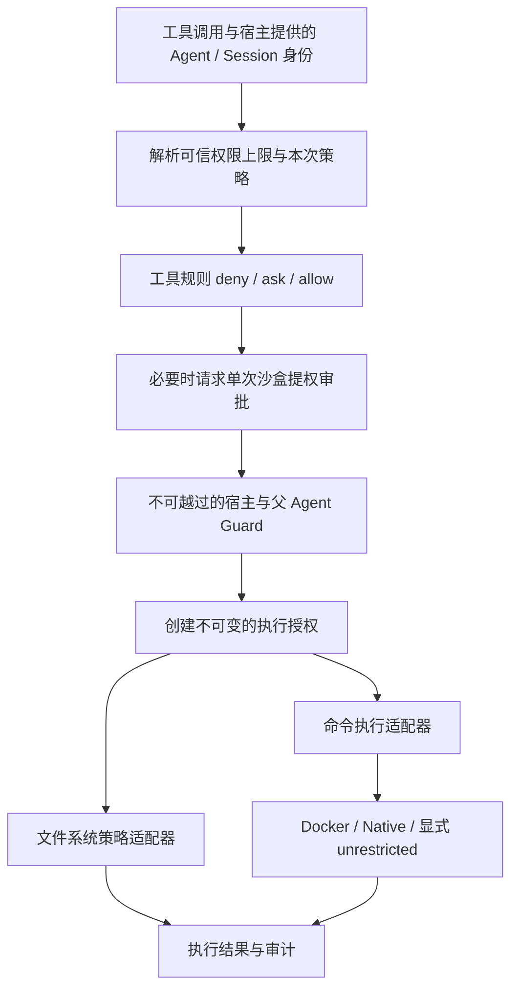

# DSH 风格沙盒与 Agent 权限设计

状态：用户于 2026-11-01 确认；本文为实施契约，平台实际验证范围见 sandbox/README.md。

## 目标与现状

用户要求 goagent-harness 的沙盒采用 DSH 的设计，并设计 Agent 权限。
目标是统一每次工具调用的策略、审批和实际执行约束，同时保留当前 Docker 用户的行为。
参考 DSH 固定提交 `ce7073d51254c26cd63b22a60835b8f948deb447`；本仓库基线 `11520f497ae3c418ee086543b8789d510abf120a`。

现有 `preset/builtin.go` 已支持 read-only、workspace-write、danger-full-access。
受限命令依赖 GoAgent 的 DockerExecutor；LocalExecutor 无文件系统或网络隔离。
`preset/build.go` 已提供工具策略、审批与不可由审批越过的 Guard。
子 Agent 已继承父 PreHook/Guard、approval: never，并检查模式等级。
不足是：没有本机 OS 沙盒、没有逐调用模式解析，模式等级检查不足以表达目录与网络上限。

## 方案比较

| 方案 | 收益 | 代价 |
|---|---|---|
| 只增加 native 执行器 | 改动小 | 文件工具与执行器仍缺乏统一策略，不能完成逐调用提权 |
| 统一策略与权限，在执行层保留 Docker 并增加 native（推荐） | 对齐 DSH 分层，兼容现有容器隔离 | 需要修改装配、工具上下文、授权与执行适配 |
| 全面以 native 替换 Docker | 默认无需容器 | 改变默认断网及宿主文件可见性，现有配置不能等价迁移 |

推荐第二种；尚未把推荐记为用户已选择。
不复制 DSH 的默认读取范围，也不将工作目录分离宣称为安全边界。

## 调用与执行模型

审批与实际约束分开。任何 allow、会话批准、配置 TrustStore 都不能越过宿主上限。
身份与已批准策略由宿主注入，不从模型工具参数或任务文本接受。
所有执行入口，包括 Git、linter、搜索所用子进程，必须经过相同执行适配器。
MCP、hooks 和任意 Go 插件属于独立执行面：没有接入该适配器就不声明已被本地命令沙盒覆盖。

## 策略契约

新增 Harness 自有 `sandbox` 包，不要求 GoAgent 改变 env.Executor 的公共接口。
提供 Policy、Resolver、Runner、EnforcementReport、PolicyFileSystem 和 ExecutorAdapter。
ExecutorAdapter 实现现有 env.Executor；新增能力报告独立于旧 Capabilities，不能把 native 伪装成 Container。
coding.Workspace 通过可选的执行策略接口消费当前调用授权；老接口继续可用。

每次调用形成不可变策略，至少包含：

- mode：read-only / workspace-write / danger-full-access。
- workspaceRoot、additionalWritableRoots：规范化后的执行端目录。
- network：deny / inherit，独立于文件模式；旧配置 false 映射 deny，true 映射 inherit。
- agentID、sessionID、policyRevision、可信权限上限摘要。

解析顺序：当前调用的有效单次授权 > 宿主设置的会话模式 > preset 默认；最终必须满足宿主与父 Agent 上限。
空/未知模式拒绝；新 Resolver 零配置为 read-only，现有 workspace 组件的默认 workspace-write 保留。
danger-full-access 只绕过文件效果约束，不自动放宽 network 或工具权限；不再允许误读为一个总权限开关。

read-only 不允许业务文件写入；workspace-write 只允许工作目录、显式额外目录和后端声明的临时目录。
文件工具继续保留原有工作区读取约束。多根访问通过显式命名的工作区范围路由，沿用相对路径契约，不把所有宿主路径开放给旧工具。
额外目录是可信配置，不能由模型随提权请求自增。必须校验存在性、实际目录与符号链接；执行前重新验证。
目录移动、符号链接替换、挂载变化的竞态必须说明；不能把进程内路径判断称为内核隔离。
敏感文件黑名单只作为文件工具的纵深约束，不承诺 shell 中的相同秘密不可读。

## 后端契约与支持范围

| 后端 | 文件约束 | 网络 | 实现要求 |
|---|---|---|---|
| Docker（保留默认） | 工作区按模式挂载；容器不挂载任意宿主目录 | deny 使用 none | 额外目录显式挂载；报告容器可写层/临时区范围 |
| Linux native | 首先 Bubblewrap；Landlock 后续独立适配 | bwrap deny 使用网络命名空间；Landlock 未证明支持则拒绝 deny | 只读根、按目录放开写权限、子进程受约束 |
| macOS native | Seatbelt / sandbox-exec | deny 必须由已验证的 profile 执行 | 不能把 allow-default 配置报告为断网 |
| Windows native | 后续实现受限 token / ACL | 未验证时不承诺 | 首期 native 返回 unavailable，Docker 仍可用 |
| unrestricted | 不实施文件沙盒 | 仅可声明 inherit | 必须显式可信授权；不能承接 network: deny |

这是分阶段移植 DSH 的设计，不宣称首期具备 DSH 全部平台能力。
后端不可用、探测失败、请求的网络约束无法兑现时拒绝执行；不回退为 unrestricted。
探测必须验证实际约束，不能只判断可执行文件是否存在。
报告 backend、full/partial/unavailable、实际可写目录、网络约束、失败原因。
full 仅代表兑现声明的契约。要求 full 时不接受 partial；后端切换不能放宽请求策略。
本机后端仍共享宿主资源，并不提供通用秘密隔离；不可信租户应使用独立环境。
默认过滤命令子进程继承的 API token 等环境变量，只允许宿主白名单；这不等于阻止读取宿主上的凭据文件。

## Agent 权限

权限由四个维度组成：工具动作、资源范围、执行环境、审批策略。角色只是预设，不是硬编码特权。

| 建议角色 | 默认文件模式 | 工具动作 | 命令与对外写入 |
|---|---|---|---|
| reader / reviewer | read-only | 读取、检索；禁止写文件、git_commit | 测试命令仍需策略授权，不能按“审查者”身份自动放行任意 shell |
| coder | workspace-write | 工作区内编辑、检索 | 命令默认 ask；受限环境中的已授权操作可以自动执行；发布默认 deny |
| coordinator | read-only | 分派、读取任务、汇总 | 不因调度职责获得执行、发消息或发布权限 |
| publisher | 按任务显式指定 | 仅开放宿主指定的仓库/接收方与动作 | 推送、发布、外部消息默认 ask；批准绑定具体资源与内容 |

独立后台 worker 的权限由宿主直接授予。只有委派型子 Agent 才求父子交集；
coordinator 为只读时不能通过普通子 Agent 委派创建可写 coder，须使用宿主定义的独立 worker 调度通道。

工具裁决沿用 deny > ask > allow，未匹配默认 ask；approval: never 表示 Ask 拒绝，而非全部允许。
子 Agent 的工具集合、目录集合、可写模式、网络、审批能力均不得超过父 Agent。
网络 deny 不得被子 Agent 改成 inherit；子目录/额外根按真实路径做集合包含检查，不能只比较模式 rank。
规则尽量匹配工具名与结构化动作/资源；命令前缀不是安全隔离边界。
外部消息、发布、密钥解析等动作须由各工具的可信参数解析器贡献资源信息；未知工具不自动套用文件规则。

## 单次提权与会话安全

工具可接受 sandbox_permissions 与 justification，成对校验，只允许请求更宽的文件模式。
请求模式不能超出部署/父 Agent 的最高可批准上限；网络扩权和增加目录不隐含在文件模式提升中。
明确 deny 不能用提权重试覆盖。批准仅适用于准确的工具、参数摘要、Agent、Session、调用 ID、策略版本。
绑定参数的摘要由可信代码计算；执行前校验并一次消费，不能通过复制参数重用。
提权使用独立审批入口，不参与现有 Pipeline 按 Session/Tool/Args 的并发审批合并。
单次消费的单位为一次工具调用：工具执行开始时生成不可变调用上下文，multi_edit、Git、linter 等内部操作继承它；
不是每次文件操作或 Executor.Run 消费一次批准。调用结束即失效，未使用授权在取消时撤销。
提权不提供 AllowedSession；审批 unavailable / rejected / cancelled / 超时一律不执行。
普通工具会话批准也不能跳过沙盒提权、Guard 或已变化的策略。

会话模式变更仅允许宿主 API 执行，记录版本和变更事件；模型看到的是事实快照。
没有稳定 Session 身份时只支持静态策略，不允许把空 Session 的授权共享给其他调用。
并发调用持有各自快照，单次提权不能修改共享 Workspace.mode；策略版本变化后，尚未执行的旧授权失效。
恢复时依据宿主重新加载策略。未完成的调用不能复用上次批准；已有日志结果可回放，但不能把回放批准用于新副作用。
静态部署配置摘要、后端契约与资源上限进入 Assembly manifest，恢复不匹配时沿用现有拒绝机制。
会话模式与单调策略版本独立持久化，不加入 Build 时生成的静态 manifest；恢复后重验当前策略并使旧批准失效。
审计记录裁决、批准、策略摘要、后端与实际执行结果；不写入秘密环境变量或凭据内容。

## 变更位置、兼容与验收

主要变更：新增 sandbox 包；修改 preset 的 workspace/permissions/source/build/subagent；
coding 的文件与命令工具消费调用授权；补充示例、迁移文档和用户说明。
基础 GoAgent 当前接口不变；只有确需通用扩展点时另列兼容变更，不偷偷修改上游工作区。
旧 YAML 默认 Docker、network: false、工作区文件路径与审批语义保留。
executor: native 为显式新增选项；旧 local 仍表示不隔离，不能更名后伪装受限能力。

验收必须覆盖真实边界，而不仅断言生成的命令参数：

1. read-only 拒绝文件工具、shell 及其子进程写入；workspace-write 允许工作区写入并拒绝外部写入。
2. 显式额外目录、临时区、符号链接、路径穿越、恶意工作目录与特殊路径的行为。
3. 后端不存在/启动失败、网络不支持、partial 与普通命令非零退出互相区分。
4. localhost 与外网连接在 deny 下均被阻断；无法验证的平台标为未验证，不能通过单测伪造支持。
5. 批准前零副作用；单次授权不可重用；参数/身份/版本变化、取消、并发隔离和恢复重试。
6. 子 Agent 尝试扩大工具、目录、网络与审批能力都被拒绝；外部工具权限不会因文件模式而自动放宽。
7. 既有 Docker/权限/plan-mode/subagent/持久执行集成测试通过；macOS 与 Linux 后端分别在真实系统验证。

首期实施顺序：策略/权限与回归测试 → Docker 适配 → macOS Seatbelt 与 Linux bwrap → 会话/提权恢复验证。
Landlock 已实现（Bubblewrap 不可用时回退），SSH 见 `sandbox/sshsandbox`。Windows native 尚未实现，继续明确 unavailable，不标成 DSH 完整平台对等。

## 参考

- https://github.com/deepseek-ai/deepseek-harness/blob/ce7073d51254c26cd63b22a60835b8f948deb447/packages/sandbox/sandbox/src/index.ts
- https://github.com/deepseek-ai/deepseek-harness/blob/ce7073d51254c26cd63b22a60835b8f948deb447/packages/sandbox/sandbox/src/escalation.ts
- https://github.com/deepseek-ai/deepseek-harness/blob/ce7073d51254c26cd63b22a60835b8f948deb447/packages/sandbox/sandbox-local/src/profiles.ts
