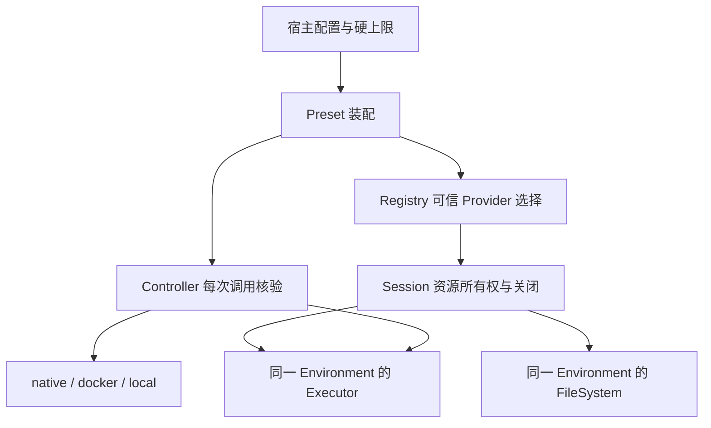

# Sandbox 设计

日期：2026-11-01。本次合并保留主线本机/容器策略执行，加入供应商无关的 Provider 生命周期；仓库不包含远端供应商适配器或 SDK。使用入口见 [指南](../guides/SANDBOX.md)，结构化权限见 [本机后端](../../sandbox/README.md) 与 [审批控制器](../../permissions/README.md)。

## 分层

GoAgent 提供 Agent/workflow 和 `harness/env` 接口；Harness 提供装配、授权和资源管理。宿主选择可信实现、保存凭据、建立任务命名空间并处理未知结果。模型只能请求受控工具，不能决定 Provider 实例 ID、密钥或审批上限。

## 权限与执行是不同边界

主线继续以 `sandbox.Policy` 表达文件模式、工作区、附加可写目录和网络，以 `permissions.Controller` 核验单次批准、会话状态和父级硬上限。子 Agent 不得扩大文件、网络、环境变量或宿主授权。

远端 Provider 的 `Isolated`、`Container`、`Network` 是能力声明，不能代替逐次结构化策略强制。通用 managed 装配必须核对实际执行器的策略能力；不能兑现的配置在分配/装配或执行前拒绝。具体支持矩阵以 [使用指南](../guides/SANDBOX.md) 和实现为准，不根据布尔声明推导安全性。

## 所有权与关闭

Registry 用可信 Namespace 与派生 Scope 区分任务和子 Agent。默认 Create；Resolver 返回既有 ID 时 Connect。新建且未 Retain 的资源由 Session 销毁；借用或 Retain 的资源仅断开本地视图。返回 Session 与 error 并存表示宿主已经取得待清理资源，必须负责关闭。

Session 关闭先禁止新操作、取消在途工作，再等待实际返回，最后按所有权 Destroy/Close。超时不等于资源已销毁；关闭可重试。宿主还须在装配失败、任务取消及退出时关闭 Registry。现有内存 Registry 不是跨进程资源台账，不承诺进程崩溃后自动回收。

## 路径、写入与未知结果

远端 Root 是后端路径，不隐式上传或挂载 Host.Root。具体实现须保证 FileSystem 与 Executor 属于同一 Environment，核验路径规范化、链接、条件写、原子替换和输出限制。coding 的 `.git` 文件变更保护保留；它不等同于禁止所有已授权命令执行 Git。

ErrUnconfirmed 表示操作结果未知，不可转成“没有执行”或普通可自动重试失败。业务副作用由宿主核对；结构化执行预算和模型用量仍由 GoAgent 负责，不在 Provider 再建 Agent 循环。
