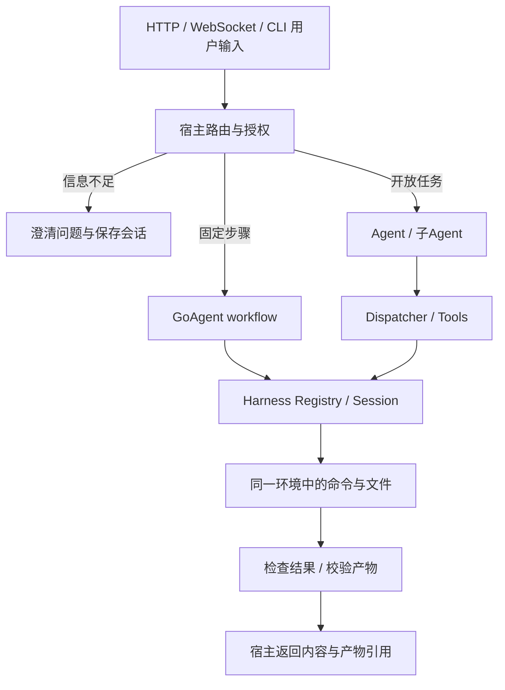

# Sandbox 场景与业务流程

日期：2026-11-01。当前可运行案例：[编码工具](../../sandbox/opensandbox/examples/coding/main.go)、[固定workflow](../../sandbox/opensandbox/examples/workflow/main.go)。下面将**已有代码**、**宿主可组合流程**和**需要新增的能力**分开。接口细节见[参考](../reference/SANDBOX_API.md)，环境要求见[接入指南](SANDBOX.md)。

## 从入口到执行环境

入口协议与执行后端独立。WebSocket连接不是PTY，也不是沙盒网络授权；浏览器页面可以只是宿主前端。沙盒生命周期与入口连接策略由业务定义，不能让用户断线自动意味着删除保留实例，也不能让断线后的任务无限运行。GoAgent入口说明见[HTTP/SSE/WebSocket指南](https://github.com/kart-io/goagent/blob/master/docs/guides/HTTP_AGENT.md)，不在Sandbox模块新建HTTP服务器。

## 场景状态表

| 场景 | 状态 | 当前做法 | 尚需补充 |
| --- | --- | --- | --- |
| 模型使用编码工具读写项目 | 可运行案例 + 真实preset验收 | coding.New或preset.Build注入同一Session的FS/Executor | 项目输入同步、业务模型/审批、结果发布 |
| 明确输入的固定数据转换 | 可运行workflow案例 | prepare → command → read结果，不调用子Agent | 业务输入schema、产物总量与业务验收 |
| 用户意图不明确 | 宿主组合设计 | 先澄清，不分配执行实例 | 澄清状态/候选动作由业务实现；没有自动IntentRouter API |
| 主Agent委派专业子Agent | 已有preset装配 | 每个完整组件路径独立Scope/实例 | 业务任务拆分、结果约束和产物交接 |
| 并行分析/互审 | 宿主组合设计 | 独立实例执行，父级汇总结构化结果 | 总并发额度、取消传播、冲突合并策略 |
| 长任务或人工审批后继续 | 部分能力已有 | 宿主Retain并持久记录，恢复时Connect同实例+PinManifest | 自动续期、持久台账与租约接口待实现 |
| 批量文档/图表生成 | 可组合，未单独端到端验收 | 专用镜像、受限Run、读回产物 | 超4MiB文件、目录同步、图片/PDF依赖与业务校验 |
| 浏览器自动化或CI | 可组合，未验证特定镜像 | 镜像需同时包含python3和浏览器/测试工具；命令有界结束 | Chromium依赖、资源与syscall兼容实测 |
| 网页实时预览/交互终端 | 尚未适配 | 不把后台命令或WebSocket入口当作已支持的服务会话 | 端点授权、PTY/服务生命周期、断线恢复 |
| 相同环境分叉为多个工作区 | 尚未适配 | 当前默认新建或同实例Connect | SnapshotID/模板、派生身份和清理管理 |

## 1. 意图不明确：先澄清，再分配

用户输入“帮我处理这个项目”，但缺少目标、输入文件或输出要求时，宿主保存待澄清状态，返回需要补充的信息。此时不创建子Agent沙盒，也不猜测具有副作用的workflow。

宿主路由至少区分：clarify、workflow、agent、reject。它是业务决策结果，不是当前Harness公开类型。明确后的固定转换走workflow；需要规划和工具选择的开放任务走Agent。两条路径都必须经过相同租户、审批和资源上限。

## 2. 固定workflow：输入明确时直接执行

已有示例上传input.txt → Python生成output.txt → 读取并校验返回值。它没有模型调用，也没有额外子Agent。生产扩展时按顺序做：校验业务参数、获得Session、写入输入、运行固定Argv、检查ExitCode、读取并校验产物、关闭会话。

Command.Argv不经shell解析；需要shell时由工具明确调用sh -c。不要把用户字符串直接拼接到固定脚本。已知非零退出是业务结果，传输错误/取消/未知停止是另一类结果；先检查ErrUnconfirmed，再判断普通超时。

## 3. 主Agent → 子Agent → Tools

已有preset子Agent在构建时装配子Assembly；Sandbox Scope包含完整委派和workspace组件路径。实例是在装配阶段分配，而不是根据每次模型调用动态创建。因此“大量可选专家但每次只用一个”的场景要先由宿主筛选要构建的preset，当前没有沙盒惰性分配接口。

父级的网络/沙箱上限会跨越没有workspace的中间Agent继续继承，拒绝扩权在分配前发生。权限交集不等于完整租户隔离，Namespace仍需宿主绑定认证身份。

子Agent彼此不共享默认可写工作区。若分析Agent产出修复建议，让父级校验结构化建议，再交给编码Agent；不要把另一个实例的绝对路径当成可读文件位置。

## 4. 并行执行与产物交接

建议采用“独立执行 → 校验清单 → 父级汇总”。例如两个审阅Agent分别分析，父级比较差异后只由一个受控写者提交代码。若多个Agent直接写同一环境，任意命令可绕过辅助程序锁，无法据此获得全局CAS。

产物交接清单至少含：来源task/instance、相对路径、类型、字节数、SHA256。宿主读取并验证A的产物，再上传到B；在A关闭销毁前完成读取。跨实例流转目前需要宿主实现，`Registry.Resolve`不是文件共享协议。

固定输入/输出案例可直接用FileSystem；大文件、很多小文件或归档需要单独的有界同步协议。不能只提高单文件上限就认为有了任务总量控制。

## 5. 人工审批、断线和恢复

短暂停顿可继续使用当前任务的Session。需要跨进程恢复时：在宿主台账持久记录任务与实例映射，明确Retain，由有权限的Resolver返回原ID；再核对Manifest。Registry本身的内存状态不会跨进程保存。

TTL默认10分钟且当前不自动续期；Retain不阻止到期。缺失或已过期的实例应返回明确恢复失败，不静默新建一个空实例继续原Run。当前原生SDK的续期、Pause/Resume探针不等于Session已有对应方法；受管生命周期接口仍是后续计划。

用户取消、WebSocket断线、任务完成、审批等待和服务退出是不同事件，应分别配置：取消工作、暂时保留、持久化后排空或最终删除。借用实例不能因某个入口断线就被该借用者删除。

## 6. CI、文档和浏览器任务

这些任务复用同一个Provider接口，不要求重写Agent内核。镜像需要目标工具以及当前适配器的python3/sleep。图表或PDF生成可用固定命令并读回文件；代码构建可运行go test；浏览器可运行一个在finally中关闭浏览器的有界脚本。

本轮只验证固定Python镜像，没有验证Chromium、浏览器GPU、Go工具链、PDF字体或所有syscall。服务端口预览、交互式终端和长期后台进程也不能由普通Run的成功返回推导为已支持。

## 7. 成功与失败的业务定义

| 观察到的结果 | 业务层应如何处理 |
| --- | --- |
| ExitCode=0且产物通过验证 | 可报告该步骤成功 |
| ExitCode非零 | 返回工具/业务诊断，不伪装传输故障 |
| 普通已确认超时 | 按业务策略终止、缩小任务或重新规划 |
| ErrUnconfirmed，即使同时有DeadlineExceeded | 记录实例/命令身份，停止自动重放，进入对账 |
| ErrStale/ErrExists | 重新读取或合并，不无条件覆盖 |
| 产物缺失、格式不符或hash不符 | 步骤不成功；不要发布不完整结果 |
| Close失败或期限到 | 保留清理责任，Registry重试或进入持久GC队列 |

建议由父级返回业务结果和产物引用，不向普通最终用户泄露控制服务地址、密钥或内部命令管理凭证。资源指标、生命周期状态和部署声明进入宿主运维视图。
