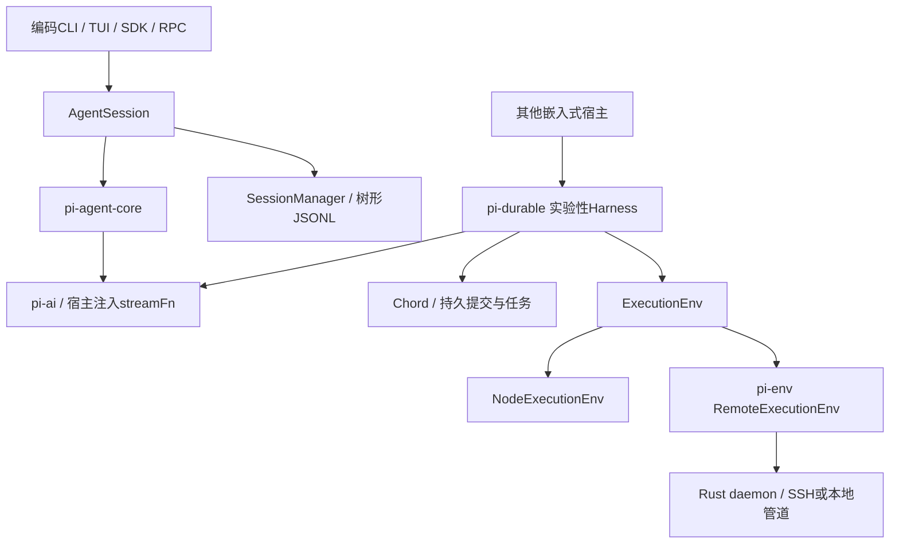

# Pi Agent 设计调研与 GoAgent/Harness 对照

日期：2026-11-01。本文的Pi指原`badlogic/pi-mono`，该地址当前跳转到`earendil-works/pi`。固定源码提交：`2c8d1feb147f6b3d97e855da803bfe7b19f3c403`；相关package.json版本为1.4.0、包名前缀为`@earendil-works/*`。这是源码快照，不等同于验证某个npm已发布版本。出处、checksum和验证环境见[证据清单](../evaluation/2026-11-01-pi-agent/sources.json)。

对照基线：Harness `4782150`，依赖GoAgent v0.32.2。本轮完成设计与行为调研，不迁入TypeScript运行时，不更改GoAgent执行语义。后续任务见[采纳计划](../design/PI_AGENT_ADOPTION_PLAN.md)。

## 1. 先区分两条运行路径

Pi当前不只是旧资料中的“Agent循环加四个工具”，但也不能把仓库里的所有新包当成编码CLI已经统一采用的实现。

- `pi-agent-core`提供有状态循环、工具执行和事件；不默认拥有供应商目录、会话存储或沙盒生命周期。
- 编码CLI的`AgentSession`组合循环、消息、扩展、压缩与`SessionManager`；交互/print/JSON/RPC共用这一层。
- `pi-durable`是**实验性独立Harness**，以持久Conversation、Document和Task运作，包依赖不包含pi-agent-core，不能把它当成CLI会话存储的同义词。
- `pi-env`面向Pi Durable的远端ExecutionEnv，不是创建VM/容器的资源管理服务。

来源：[包结构](https://github.com/earendil-works/pi/blob/2c8d1feb147f6b3d97e855da803bfe7b19f3c403/README.md)、[AgentSession](https://github.com/earendil-works/pi/blob/2c8d1feb147f6b3d97e855da803bfe7b19f3c403/packages/coding-agent/src/core/agent-session.ts)、[Durable包声明](https://github.com/earendil-works/pi/blob/2c8d1feb147f6b3d97e855da803bfe7b19f3c403/packages/durable/package.json)。

## 2. Agent循环：把消息处理和模型协议分开

Pi循环内部使用AgentMessage，应用可以扩展消息类型；请求模型前先`transformContext`，再`convertToLlm`。这样UI详情、应用事件与模型可见消息不必是同一种数据。当前代码还把工具声明变化作为系统消息的一部分维护，避免实际工具集与模型看到的声明漂移。

模型请求通过宿主注入的`streamFn`完成；缺少默认stream函数时明确报错，而不是在核心循环隐式选模型/读凭证。编码产品层和模型配置层负责把可用运行时装配进来。

请求前后有明确边界：`prepareNextTurn`可准备压缩等状态；队列消息进入后，`prepareRequest`可替换规范的请求上下文；`finishTurn`在完整assistant和工具结果之后、turn_end之前决定继续或结束。错误/abort仍是硬退出，不能被普通续跑提示覆盖。

GoAgent已有泛型State、llm.Message、PreStep/Request/TurnStopping及提示词扩展点。建议补“业务状态→持久会话→模型投影”的契约与例子，而不是另外复制AgentMessage类型或在Harness建立新循环。

来源：[Agent核心说明](https://github.com/earendil-works/pi/blob/2c8d1feb147f6b3d97e855da803bfe7b19f3c403/packages/agent/README.md)、[循环源码](https://github.com/earendil-works/pi/blob/2c8d1feb147f6b3d97e855da803bfe7b19f3c403/packages/agent/src/agent-loop.ts)、[当前Harness扩展装配](../../preset/loop.go)。

## 3. 工具并发：完成顺序与历史顺序不同

当前Pi默认parallel，和一些旧资料的默认串行描述不同。并行批次先顺序执行preflight，再并发运行允许的调用；完成事件可按实际完成顺序出现，但最终toolResult消息按assistant声明的顺序写入。任一工具声明`executionMode: sequential`时，整批转串行。

`beforeToolCall`在参数校验后运行，可以阻止或修改参数；源码测试明确覆盖“修改后不重新校验”。这是可信宿主钩子的设计选择，不应照搬为允许不可信输入绕过验证。GoAgent已有Dispatcher校验、授权和替代工具重新检查，应保留这些保证。

`terminate:true`是工具批次结束提示；只有整批最终结果都给出该提示才停止自动模型续跑。它不是命令中断确认，也不证明业务成功。

模型可见content、结构化结果、持久details、UI渲染各有用途；若扩展修改/脱敏输出，也要同步处理结构化副本，避免只改短文本留下另一个泄露路径。

来源：[工具执行源码](https://github.com/earendil-works/pi/blob/2c8d1feb147f6b3d97e855da803bfe7b19f3c403/packages/agent/src/agent-loop.ts)、[原始测试](https://github.com/earendil-works/pi/blob/2c8d1feb147f6b3d97e855da803bfe7b19f3c403/packages/agent/test/agent-loop.test.ts)、[结果类型](https://github.com/earendil-works/pi/blob/2c8d1feb147f6b3d97e855da803bfe7b19f3c403/packages/agent/src/types.ts)、[GoAgent Dispatcher](https://github.com/kart-io/goagent/blob/v0.32.2/tools/dispatcher.go)。

## 4. 事件和运行中输入

Pi Agent区分agent、turn、message、tool的开始/更新/完成事件。Agent类等待异步订阅者；assistant message_end作为工具preflight前的屏障，让钩子看到已更新的assistant消息。

steer与followUp是不同的队列：前者在正常轮次边界插入，后者等当前工作自然结束再进入。新prompt不能在Agent忙时任意并发启动。编码产品层还有重试、压缩和队列延续，因此其`agent_end`不总是最终空闲；产品层用`agent_settled`表达最终settle。

GoAgent已有Handle.Steer/Inject/Followup/Redirect，且持久运行中的Redirect有降级语义。需要对照的是边界、队列优先级和最终完成信号，不是新增同名API。流式前端也不应把某个模型message_end误当作文件、子任务和清理全部结束。

来源：[Agent类](https://github.com/earendil-works/pi/blob/2c8d1feb147f6b3d97e855da803bfe7b19f3c403/packages/agent/src/agent.ts)、[编码扩展事件说明](https://github.com/earendil-works/pi/blob/2c8d1feb147f6b3d97e855da803bfe7b19f3c403/packages/coding-agent/docs/extensions.md)、[GoAgent Handle](https://github.com/kart-io/goagent/blob/v0.32.2/builder/handle.go)。

## 5. 会话树、分支和压缩

编码CLI会话用id/parentId形成树，当前leaf决定下一次模型请求的活动分支；/tree在同一会话内导航，fork/clone产生另一个会话文件。压缩追加summary和保留边界，原始条目仍留在树中；模型上下文重建与历史浏览因此分离。

这不等于文件系统回滚。本轮用实际SessionManager做场景探针：记录写入结果后回到先前分支，模型投影不再含该toolResult，但磁盘文件仍是已写入内容；切回原分支也不自动改变文件。

GoAgent v0.32.2的session.Store已经有Fork，不能把分支当成完全缺失的核心功能。缺少的是面向产品的树形导航、分支关系展示和执行身份衔接。复用Store.Fork时，必须分别管理会话ID、业务Run/ExecutionKey、子任务ID和SandboxID；复制历史不能自动撤销外部支付、Git提交或沙盒变更。

来源：[SessionManager](https://github.com/earendil-works/pi/blob/2c8d1feb147f6b3d97e855da803bfe7b19f3c403/packages/coding-agent/src/core/session-manager.ts)、[压缩机制](https://github.com/earendil-works/pi/blob/2c8d1feb147f6b3d97e855da803bfe7b19f3c403/packages/coding-agent/docs/compaction.md)、[GoAgent Store.Fork](https://github.com/kart-io/goagent/blob/v0.32.2/core/session/store.go)、[分支探针](../evaluation/2026-11-01-pi-agent/session-probe.test.ts.txt)。

## 6. 扩展、skills与信任

扩展是进程内TypeScript代码，可注册工具、命令、事件和UI；skills是按需加载的说明与资源，prompt template负责输入展开。三者的能力与信任等级不同，不应统一当成“提示词插件”。

当前Pi有project trust，用于控制项目设置、MCP、扩展、包等资源是否加载；官方安全说明同时指出，部分上下文文件仍可加载，project trust也不限制工具启动后的OS权限。默认不是每次工具调用都询问批准。扩展在宿主进程执行，注册一个远端工具不会使其他扩展也自动进入沙盒。

GoAgent/Harness现有Source.Trusted、TrustStore、Needs/Limits、权限Pipeline和沙箱检查值得保留。可以借鉴“资源发现—信任决定—能力装配—模型投影”的清晰阶段，不复制更宽松的CLI默认权限。新增扩展生命周期时，失败加载/卸载须关闭其资源，不依赖模型自行清理。

来源：[扩展API](https://github.com/earendil-works/pi/blob/2c8d1feb147f6b3d97e855da803bfe7b19f3c403/packages/coding-agent/docs/extensions.md)、[安全边界](https://github.com/earendil-works/pi/blob/2c8d1feb147f6b3d97e855da803bfe7b19f3c403/packages/coding-agent/docs/security.md)、[当前Preset装配](../../preset/build.go)。

## 7. 实验性Durable：持久状态与副作用重放

pi-durable用Conversation保存不可变条目，用Document保存类型化状态，用Task表达可恢复执行。提交接收持久存储receipt后才向观察者发布；MemoryStorage只提供内存中的提交，不能因此声称跨进程持久化。

工具默认unsafe。中断恢复时，只有已经记录的策略和当前工具策略都为safe才允许重跑；否则返回中断及可能的部分结果，不假装从未执行。safe是工具作者的承诺，不使任意外部API天然幂等。原始测试覆盖SQLite重开、意图之后中断、策略变化、部分输出和所有权取消。

持久提交的逻辑边界也不等于电源故障保证。官方说明SQLite WAL采用synchronous=NORMAL，JSONL可选择fsync；本轮测试不覆盖断电、硬件故障或所有存储后端。

GoAgent已有durable.OperationPolicy、Store、会话日志与typed workflow。借鉴项是“存储确认后可见”、重放策略变更、未知副作用和崩溃循环上限的契约测试。不要把pi-durable移入Harness作为第二个运行时，也不把普通Sandbox.Run自动标成safe。

来源：[Durable说明](https://github.com/earendil-works/pi/blob/2c8d1feb147f6b3d97e855da803bfe7b19f3c403/packages/durable/README.md)、[工具恢复源码](https://github.com/earendil-works/pi/blob/2c8d1feb147f6b3d97e855da803bfe7b19f3c403/packages/durable/src/harness/tool.ts)、[恢复测试](https://github.com/earendil-works/pi/blob/2c8d1feb147f6b3d97e855da803bfe7b19f3c403/packages/durable/test/harness-tools-recovery.test.ts)。

## 8. 子Agent所有权：不能笼统说Pi不支持

编码CLI的默认产品说明仍说不内置subagents/plan mode，但同仓实验性Durable已经提供owned Conversation/Task组合与子Agent例子。子会话可以由工具任务拥有；前台子工作随父任务abort，后台anchor显式改变所有权和等待边界，重启时通过task/request身份找回原子会话。

当前Harness的preset子Agent是同步装配的工具委派；Invoke显式移除子层journal，父级记录整体调用，恢复取决于父调用策略。它支持子Agent，但不是Durable owned-child状态机的直接对应物。

建议在现有GoAgent持久语义上定义前台/后台、等待、取消和租约责任，再按需扩展。后台不是“忽略context并启动goroutine”，也不能因父输入完成就丢失资源清理责任。固定业务步骤仍走已有workflow，不必改成模型调用子Agent。

来源：[默认产品边界](https://github.com/earendil-works/pi/blob/2c8d1feb147f6b3d97e855da803bfe7b19f3c403/README.md)、[Durable Abort and Subagents](https://github.com/earendil-works/pi/blob/2c8d1feb147f6b3d97e855da803bfe7b19f3c403/packages/durable/README.md#abort-and-subagents)、[当前子Agent](../../preset/subagent.go)。

## 9. 执行环境与远端协议

Pi Durable的ExecutionEnv可以由宿主按conversation/cwd构造。相同env.id应指向相同文件空间，供进程内文件变更队列协调。NodeExecutionEnv是本机实现，pi-env用Rust daemon经SSH或本地管道提供远端实现。

值得借鉴的协议设计包括：request ID、JSON控制信息与原始二进制分离、打开文件/目录的句柄、分页与批量列举、命令stdout/stderr分流、输出背压、cancel、hello的protocol/version/features、连接丢失的unknown结果、句柄绑定原daemon而不在重连后误用。

这是源码核对，不是本轮Rust daemon/SSH验收。其cwd是路径基准，支持绝对路径和上层路径，不是GoAgent工作区根限制；Node式write也不等同于我们辅助程序的条件写、原子替换和fsync契约。文件队列只协调本进程的edit/write，不约束bash或其他进程。

对当前OpenSandbox适配器，可研究有界批量FS或受控长连接辅助服务来减少逐操作上传/启动/轮询；但必须保留Root限定、CAS、最终.git保护、输出上限和ErrUnconfirmed，不能直接复制Pi的较宽Node语义。

来源：[pi-env说明](https://github.com/earendil-works/pi/blob/2c8d1feb147f6b3d97e855da803bfe7b19f3c403/packages/env/README.md)、[线协议](https://github.com/earendil-works/pi/blob/2c8d1feb147f6b3d97e855da803bfe7b19f3c403/packages/env/docs/protocol.md)、[语义](https://github.com/earendil-works/pi/blob/2c8d1feb147f6b3d97e855da803bfe7b19f3c403/packages/env/docs/semantics.md)、[进程内文件队列](https://github.com/earendil-works/pi/blob/2c8d1feb147f6b3d97e855da803bfe7b19f3c403/packages/durable/src/tools/file-mutation-queue.ts)。

## 10. Code Mode、工具发现与workflow

当前Durable还提供可选Code Mode：模型写脚本，通过工具桥组合多个调用；工具可区分model与其他tools作为调用者，deferred工具按需发现。控制模型看到的工具集和后端实际允许调用的工具集是两件事，权限不能仅靠“没有出现在提示词里”实现。

其Code Mode恢复依赖确定性执行、嵌套调用日志和版本/指纹校验，不意味着任意脚本都可安全重跑。Task Graph主要展示持久任务与所有权状态，也不等于GoAgent类型化业务Graph。

GoAgent可研究工具发现与受控组合，但固定流程继续使用workflow；脚本执行必须经过同一Dispatcher/预算/授权/副作用策略，不直接开放宿主任意Go/JS执行。

来源：[Durable Code Mode与Tools](https://github.com/earendil-works/pi/blob/2c8d1feb147f6b3d97e855da803bfe7b19f3c403/packages/durable/README.md)、[GoAgent Graph](https://github.com/kart-io/goagent/blob/v0.32.2/workflow/graph.go)。

## 11. 对照与采纳位置

| 设计点 | GoAgent/Harness现状 | 建议位置与动作 |
| --- | --- | --- |
| 小核心+产品装配 | Builder/Dispatcher/workflow在核心，Preset在Harness | 保持分层，不复制Pi完整Harness |
| 消息投影 | 泛型State、llm.Message、会话日志、PreStep已有 | 先写可见性/持久化/压缩契约与测试 |
| 队列与事件 | Handle与工具事件已有 | 核对边界和最终idle语义，补交互案例 |
| 分支 | session.Store.Fork已有 | 宿主会话导航与身份关联，不新建核心Fork接口 |
| 扩展 | 组件、权限、钩子、skills已有 | 增补信任分类、资源生命周期及结果投影规范 |
| 持久子Agent | 当前父调用记整体，子journal禁用 | 另行设计owned child run，复用核心durable |
| 远端FS | 同环境Executor/FS、受管清理和有界辅助程序已有 | Sandbox可选批量/长连接协议PoC，保留更严格语义 |
| Code Mode/延迟工具发现 | 不等同于普通workflow或现有任意工具调用 | 后置可选模块；先保证权限、预算和重放 |

## 12. 验证范围与结论

本轮在固定源码上运行79个Agent测试、99个Durable恢复/所有权/存储/分叉测试、51个Node环境一致性测试，并用实际CLI SessionManager做1个分支与磁盘副作用探针，合计230个通过。使用受控模型流，没有调用外部模型；完整CLI启动、项目扩展加载、Rust daemon/SSH、网络/VM隔离和断电持久性没有验证。

最值得采纳的是明确的层次、消息与事件边界、分支不回滚副作用、持久子工作所有权，以及有界远端协议。现有GoAgent已经覆盖的能力应补契约和验证；新的产品与远端能力按层扩展。完整命令、初始依赖问题、数据pin和复跑步骤见[验证报告](../evaluation/2026-11-01-pi-agent/REPORT.md)。
